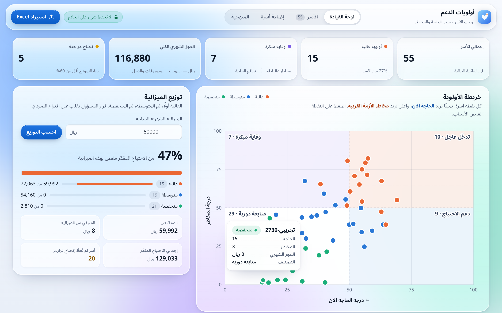

# أولويات الدعم

أداة ويب تساعد الجمعيات الخيرية في السعودية على ترتيب أولويات التبرعات حسب **حاجة الأسرة اليوم** و**مخاطر الأزمة القريبة**، للوصول إلى الأسرة قبل أن تقع في أزمة (انقطاع خدمات، تعثّر في السداد، إخلاء).

**إعداد:** مرام المطيري | ريم المطيري

> ⚠️ التقييم أداة لدعم قرار الجمعية، وليس قرارًا آليًا. لا تُستبعد أي أسرة تلقائيًا، والقرار النهائي دائمًا للمسؤول عن التوزيع.
> البيانات **سعودية فقط**: أرقام رسمية حقيقية (أهمها مسح دخل وإنفاق الأسرة 2023 من الهيئة العامة للإحصاء)، وأسر **تجريبية** مبنية عليها لأن بيانات الأسر الفردية سرية. لا بيانات من خارج المملكة، ولا بيانات أسر حقيقية في المستودع.



## الروابط

| | الرابط |
|---|---|
| الموقع (تجربة مباشرة) | https://maram-almutairi.github.io/charity-prioritization/ |
| التقرير الكامل (PDF) | https://maram-almutairi.github.io/charity-prioritization/docs/report.pdf |
| الملخص التنفيذي (PDF) | https://maram-almutairi.github.io/charity-prioritization/docs/executive_summary.pdf |
| العرض التقديمي (PDF) | https://maram-almutairi.github.io/charity-prioritization/docs/presentation.pdf |
| التقرير والملخص بصيغة Word | [docs/report.docx](docs/report.docx) · [docs/executive_summary.docx](docs/executive_summary.docx) |

*A web tool that helps Saudi charities prioritise support by each family's current Need and near-term Risk, using an explainable model. Arabic RTL interface. Nothing is stored on the server.*

## ماذا تقدّم الأداة؟

- **استيراد Excel بالسحب والإفلات** مع قالب جاهز للتعبئة، و**تقرير تنظيف** يوضّح كل تصحيح ورفض.
- **درجتان قابلتان للتفسير** (0–100): الحاجة الآن، ومخاطر الأزمة القريبة، مع نقاط كل عامل.
- **أولوية مقترحة** (عالية / متوسطة / منخفضة) من نموذج انحدار لوجستي.
- **خريطة الأولوية**: تدخّل عاجل، ووقاية مبكرة، ودعم الاحتياج، ومتابعة دورية.
- **توزيع مقترح للميزانية** الشهرية، و**قرار المسؤول** الذي يغلب على اقتراح النموذج.
- إضافة أسرة يدويًا، والتعديل، والحذف، ومسح الكل، والتصدير إلى **Excel** و**PDF**.
- **لا تخزين**: الملف يُقرأ في الذاكرة ثم يُهمل، والنتائج تبقى في الصفحة حتى تُصدَّر.

## التشغيل

يتطلب Python 3.10 أو أحدث.

```bash
python -m venv .venv
.venv\Scripts\activate          # Windows   |   source .venv/bin/activate   (macOS / Linux)
pip install -r requirements.txt

python run_all.py               # يعيد بناء البيانات والنموذج والتحليل ويشغّل الاختبارات
python backend/app.py           # ثم افتح http://127.0.0.1:5000
```

للتجربة السريعة: اضغط «تجربة ببيانات تجريبية سعودية» في الموقع، أو اسحب أحد ملفات `data/samples/`:
- `sample_families.xlsx`: 40 أسرة نظيفة.
- `sample_messy.xlsx`: ملف بأخطاء إدخال متعمدة لعرض التنظيف.

## بنية المشروع

```
├── backend/            واجهة برمجية (Flask) بلا تخزين: التقييم، والاستيراد، والتوزيع، والتصدير
├── frontend/           الواجهة (HTML / CSS / JavaScript)، عربية بخط مستضاف محليًا
├── model/
│   ├── schema.py       تعريف خانات الأسرة والتحقق منها (مصدر واحد للكل)
│   ├── cleaning.py     تنظيف ملفات Excel وتوثيق كل تعديل
│   ├── features.py     حساب المعلومات التي يستخدمها النموذج
│   ├── scoring.py      درجتا الحاجة والمخاطر وأوزانهما
│   ├── train.py        تدريب النموذجين وتقييمهما وفحص العدالة
│   └── artifacts/      النموذج المختار والمقاييس
├── analysis/
│   └── saudi_validation.py     التحقق على البيانات السعودية الرسمية (مسح الأسرة 2023)
├── data/
│   ├── generate_synthetic.py   توليد 3,000 أسرة تجريبية مبنية على الأرقام السعودية
│   ├── make_sample_files.py    ملفات Excel للتجربة
│   └── raw/, samples/
├── notebooks/          التحليل الاستكشافي (eda.ipynb) وسكربت بنائه
├── tests/              37 اختبارًا آليًا
├── docs/
│   ├── executive_summary.docx/.pdf  الملخص التنفيذي (صفحتان)
│   ├── report.docx / report.pdf     التقرير الكامل (مرفق)
│   ├── presentation.pdf             العرض التقديمي (المصدر: presentation/slides.html)
│   ├── methodology.md, ethics.md    المنهجية والاستخدام المسؤول
│   ├── impact_simulation.py         محاكاة الأثر (impact.json)
│   └── figures/, screenshots/
└── run_all.py          تشغيل كل الخطوات بأمر واحد
```

## البيانات (سعودية فقط)

| النوع | حقيقية؟ | الدور | المصدر |
|---|---|---|---|
| مسح دخل وإنفاق الأسرة السعودية 2023 (1,592 رقمًا) | **حقيقية** (رسمية) | وسيط دخل الفرد **2,896** ريال في درجة الحاجة، ووصف الأسر المستفيدة، والتحقق من الطريقة | [الهيئة العامة للإحصاء على كابسارك](https://data.kapsarc.org/explore/dataset/household-income-and-consumption-expenditure-survey/) — `data/raw/gastat_hices_2023.csv` |
| تكاليف الكهرباء من دخل الأسرة (2017–2019) | **حقيقية** (رسمية) | مقارنة فواتير الأسر التجريبية | [الهيئة العامة للإحصاء على كابسارك](https://data.kapsarc.org/explore/dataset/percentage-of-annual-costs-of-electricity-and-other-fuel-to-total-annual-househo/) — `data/raw/gastat_electricity_cost_share.csv` |
| خط الكفاية للأسرة السعودية: 8,926 ريال | **حقيقية** (دراسة سعودية) | مقارنة دخل الأسر التجريبية | [مؤسسة الملك خالد الخيرية (الاقتصادية)](https://www.aleqt.com/2014/04/12/article_840564.html) |
| حجم الأسرة 4.8، والتملّك 65.4%، وحد القسط 33.33% | **حقيقية** (رسمية) | معايرة الأسر التجريبية ودرجة «القسط مرتفع» | [التعداد 2022](https://saudipedia.com/en/saudi-census-2022)، [الإسكان 2024](https://momah.gov.sa/en/node/15202)، [البنك المركزي](https://rulebook.sama.gov.sa/node/1971) |
| 3,000 أسرة تجريبية (seed=42) | تجريبية | تعليم النموذج، وتجربة الموقع، وملفات Excel | `data/generate_synthetic.py` |

بيانات الأسر السعودية الفردية لدى الهيئة العامة للإحصاء سرية، لذلك الأسر في الأداة تجريبية مبنية على الأرقام الرسمية. التفاصيل في [data/README.md](data/README.md).

## التحقق على البيانات السعودية الرسمية

`analysis/saudi_validation.py` يبني «أسرة متوسطة» لكل فئة من **25 فئة** في مسح 2023 (الحالة الاجتماعية لربّ الأسرة، ونوع السكن، والمنطقة) ويحسب درجة الحاجة لها:

- الارتباط بين ترتيب درجة الحاجة وترتيب الدخل الرسمي: **0.85-** (الفئات الأفقر تأخذ حاجة أعلى).
- أعلى الفئات حاجة: مسكن من محسن، ومسكن من جمعية خيرية، ومسكن من أحد الأقارب.
- دخل الأسرة التي يرأسها أرمل أقل من متوسط المملكة بـ 39%، والتي تسكن مسكنًا من جمعية خيرية أقل بـ 45%.
- 87% من الأسر التجريبية تحت خط الكفاية، مقابل متوسط سعودي يساوي ضعف الخط.

ما لا يمكن قياسه بعد: الدقة على كل أسرة سعودية حقيقية، لأن بياناتها سرية. تُقاس في تجربة موازية مع الجمعية.

## النتائج على البيانات التجريبية

| المقياس (600 أسرة اختبار) | الانحدار اللوجستي |
|---|---|
| الدقة (Accuracy) | 89.2% |
| F1 (متوسط الفئات) | 89.2% |
| اكتشاف الأسر ذات الأولوية العالية | 87.3% |
| خلط بين «عالية» و«منخفضة» | 0 حالة |

في محاكاة على 3,000 أسرة، ولو دعمت الجمعية **750** أسرة بالطريقتين: يصل الترتيب حسب الحاجة وحدها إلى **0** من 485 أسرة «وقاية مبكرة»، بينما تصل الأداة إلى **116** منها. ومليون ريال تغطي 14.8% من العجز الشهري (6.74 مليون)، أو 13.3% من الدعم المقترح مع الاحتياطي الوقائي (7.52 مليون).

## الاستخدام المسؤول

- النموذج قابل للتفسير، والإنسان يقرر، ولا إقصاء آلي.
- لا أسماء ولا أرقام هوية، ولا قاعدة بيانات، ولا أي تخزين على الخادم.
- فحص للعدالة بين الفئات، والفجوات معلنة في [docs/ethics.md](docs/ethics.md).
- استُعين بمساعد ذكاء اصطناعي في البناء تحت إشراف الفريق، دون أي بيانات أسر حقيقية، مع اختبارات آلية وتحقق من كل مصدر.

## الاختبارات وإعادة الإنتاج

```bash
python -m pytest -q     # 37 اختبارًا
python run_all.py       # النتائج متطابقة في كل تشغيل (بذرة ثابتة وإصدارات مثبّتة)
```

## شكر وإسناد

- خط [Noto Sans Arabic](https://fonts.google.com/noto/specimen/Noto+Sans+Arabic) برخصة SIL Open Font License 1.1.
- أبعاد مؤشر الفقر متعدد الأبعاد: [OPHI, University of Oxford](https://ophi.org.uk/global-mpi-faqs).
